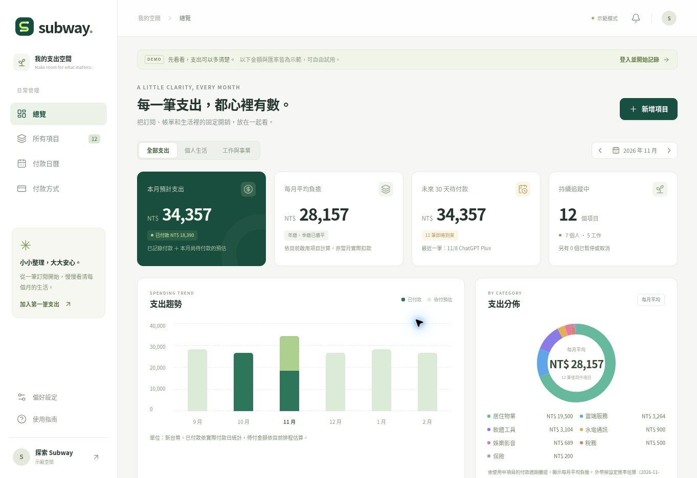

# Subway

**每一筆固定支出，都心裡有數。**

集中管理串流與軟體訂閱、稅費與水電、企業雲端服務、租賃、保險及其他週期費用。個人 side project；原始碼由 [easysun/subway](https://github.com/easysun/subway) 管理，目標網域為 `sub.ages.tw`。

[開啟私有檢視站](https://subway-easysun.ataya-3840.chatgpt.site/) · [部署與 DNS 設定](docs/deployment.md) · [驗證紀錄](docs/verification.md)

目前檢視站使用 ChatGPT 登入，僅擁有者可存取；`sub.ages.tw` 等待 DNS 驗證。這是既有 ChatGPT 工作區提供的檢視部署，尚未改為個人 Cloudflare 帳戶的公開正式服務。



## 可以做什麼

- **支出總覽：** 本月預計支出、每月平均負擔、未來 30 天待付款、六個月趨勢與分類占比。
- **項目管理：** 個人／工作分類、搜尋、每月／雙月／季／半年／年繳、固定或浮動估算、暫停與取消。
- **付款日曆：** 查看日期與當日項目，手動記錄實際付款金額、日期及付款方式。
- **付款來源：** 信用卡、銀行帳戶、第三方支付與其他來源；只保存名稱、可選末四碼與顏色。
- **多幣別：** TWD、USD、JPY、EUR；原幣金額保留，跨幣別合計採明確標示的手動匯率。
- **備份與提醒：** JSON 匯出／還原；ICS 匯出未來 12 個月的付款及提醒。
- **持久化：** 每位登入使用者的資料獨立儲存在 D1。版本檢查會拒絕過期分頁覆蓋較新資料。
- **示範空間：** 清楚標示、獨立運作，重新載入即可重置；不會自動寫入真實帳戶。

## 數字如何計算

| 顯示內容 | 意義 |
| --- | --- |
| 本月預計支出 | 本月實際記錄的付款，加上本月仍未記錄付款的預定費用 |
| 每月平均負擔 | 目前啟用項目的每期金額除以週期月數；年繳除以 12 |
| 已付款 | 使用者手動記錄的結果；不代表 Subway 曾向銀行查詢或執行付款 |
| 預估 | 浮動費用尚未確認，或外幣採手動匯率換算 |
| 金額／匯率待補 | 不納入數值總額，同時顯示缺漏筆數；不會當作 0 元 |

例如 NT$12,000 的年繳保險，月均負擔是 NT$1,000，但扣款月份預計支出包含完整 NT$12,000。提前付款依實際付款日計入，原訂月份不會再次計算同一筆。

日期使用 `Asia/Taipei` 的日曆日期。1 月 31 日月繳會在 2 月月底收斂，3 月恢復 31 日；閏日年繳亦保留原始錨點。明確選擇月底時，第一筆指定日期保留，後續使用各月最後一天。

## 技術與檔案

- React 19 / TypeScript，Vinext（Next App Router API）與 Vite。
- Cloudflare Workers + D1；Drizzle 僅管理 schema 與 migrations。
- Sites 提供目前的私有檢視部署、ChatGPT 登入與資料庫佈建。
- `lib/domain.ts`：日期、金額、匯率、支出計算、資料驗證。
- `lib/lifecycle.ts`：暫停、取消後重新啟用，保留過去的停用期間。
- `lib/workspace-service.ts`：有身份與版本檢查的 GET / PUT 工作區 API。
- `lib/export.ts`：可還原備份與日曆快照。
- `components/`：響應式總覽、日曆、表單與圖表。
- `db/`、`drizzle/`：資料庫結構與可追蹤的 migrations。
- `tests/`：金額／日曆、SQLite 帳戶隔離與競爭寫入、匯出及生命週期回歸測試。

## 本機開發

使用 Node.js 24 與 `pnpm@11.25.0`：

```sh
npm install --global pnpm@11.25.0
pnpm install --frozen-lockfile
pnpm test
pnpm typecheck
pnpm build
node --import ./scripts/sites-env.mjs ./node_modules/wrangler/bin/wrangler.js d1 execute DB --local --config dist/server/wrangler.json --persist-to .wrangler/state --file drizzle/0000_dashing_mystique.sql
pnpm dev
```

本機開發預設在 loopback `http://localhost:5173`。Portable 開發模式提供本機測試身份，點選登入即可使用；它不會包含在 production build。資料庫命令只執行一次；後續 migration 應依順序新增及套用，不要修改已套用的 migration。

`pnpm start` 可檢視 build 後的 Worker；此模式不模擬登入。`pnpm dev` 才是適合完整本機操作測試的模式。

GitHub Actions 會執行鎖定依賴安裝、測試、TypeScript 檢查與 build；沒有自動部署 production 的步驟，也不需要部署密鑰。

## 部署與身份邊界

`.openai/hosting.json` 保留本專案的 Sites identity 與 `DB` binding。Sites 發佈流程會同步原始碼、建立 archive、套用 migrations 並部署匹配版本。Public GitHub repository 與網站存取權限是兩件事；目前檢視站保留 owner-private 存取。

**這份程式依賴 Sites 的可信驗證代理。** 代理負責剝除訪客自帶的 `oai-authenticated-*` 標頭，再注入經驗證的身份。不要直接把 Worker 開放到未提供相同信任邊界的網路，或把任意 HTTP 標頭當作登入。若改為獨立 Cloudflare／其他平台部署，必須先替換身份 adapter、使用可驗證的 session，並保留每個 API 的 owner 授權。

自訂網域的 DNS 記錄需以 Sites 回傳的 CNAME 與驗證記錄為準。網域啟用狀態與目前部署連結記錄在 `docs/deployment.md`。

## 第一版的邊界

- 不會執行扣款、代繳稅款或取消服務商的訂閱；所有付款結果皆手動記錄。
- 沒有銀行、信用卡、email 或服務商帳單同步。
- 稅費日期由使用者依自己的帳單填寫；沒有內建通用法定到期日。
- 信用卡服務扣款日與銀行帳單扣款日不同；這版追蹤前者。
- 匯率是手動估算；已付款換算採當時快照，或使用者填入的實際 TWD 入帳金額。
- 日曆是靜態快照，不會自動更新。提醒由匯入的行事曆處理，沒有 email／推播排程。
- 每帳戶最多 500 個項目、50 種付款方式、3,000 筆付款紀錄，壓縮排版後的 JSON API payload 上限 1 MiB。格式化備份檔可達 4 MiB，還原會驗證實際 payload 上限。
- 個人／工作為同一帳戶的篩選，不是多人組織或家庭共用帳本。

## 資料保護

資料讀寫一律使用伺服器辨識的 owner ID。SQL 使用參數繫結；寫入要求同源 JSON，拒絕未知欄位、錯誤日期、非法金額、無效關聯及重複付款紀錄。備份會包含你輸入的財務資料，請自行妥善保存。

原始碼不包含使用者資料、真實卡號、銀行憑證或部署 secrets。`.env*`、本機 D1、執行時資料與 build 產物不納入 Git。
